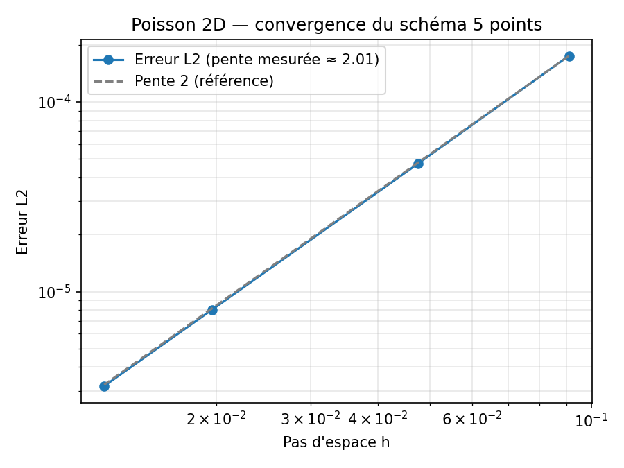
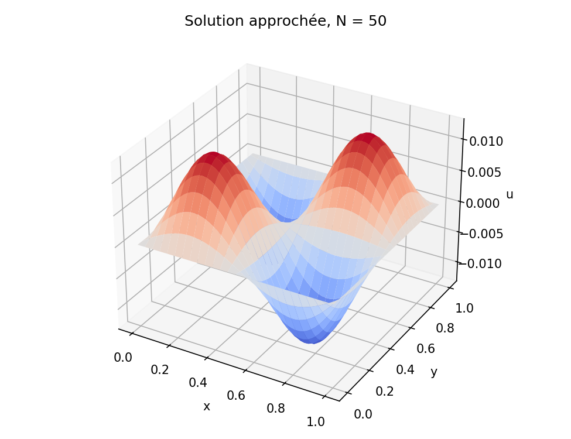

# Poisson 2D — Résolution numérique, sauvegarde HDF5 et visualisation VTK

Résolution de l'équation de Poisson 2D par différences finies, sauvegarde structurée des résultats au format HDF5, puis export VTK pour une visualisation sous Paraview.

## Problème

On résout sur le carré unité, avec condition de Dirichlet nulle au bord :

```
-Δu = f   sur ]0,1[²,   u = 0 au bord
f(x, y) = sin(2πx) sin(2πy)
```

La solution exacte est connue : `u(x, y) = sin(2πx) sin(2πy) / (8π²)`, ce qui permet de mesurer l'erreur.

## Méthode

- Discrétisation par **différences finies**, Laplacien à **5 points** sur une grille de N × N points intérieurs
- Assemblage de la matrice du système, puis résolution par **factorisation LU** (`scipy.linalg.lu_factor` / `lu_solve`)
- Calcul de l'**erreur L2** par rapport à la solution exacte et du **temps CPU** pour N = 10, 20, 50, 80
- **Sauvegarde HDF5** (`h5py`) avec une organisation hiérarchique :
  - un groupe `Sol_N<N>` par taille de maillage, contenant le dataset `Solution` et l'attribut `N`
  - à la racine, les datasets `L2_error` et `CPU_Time`
- **Relecture du fichier HDF5** et écriture d'un fichier **VTK** (grille structurée) visualisable sous Paraview

## Structure du projet

```
poisson-2d-hdf5/
├── src/
│   ├── poisson_hdf5.py     # résolution, sauvegarde HDF5, export VTK
│   └── graphiques.py       # relecture HDF5 : courbe de convergence et surface 3D
├── results/
│   ├── resultats.hdf5
│   ├── visualisation_N10.vtk
│   ├── convergence.png
│   └── solution_N50.png
├── requirements.txt
└── README.md
```

## Utilisation

```bash
pip install -r requirements.txt
cd src
python poisson_hdf5.py    # calcule les solutions, écrit resultats.hdf5 et visualisation_N10.vtk
python graphiques.py      # génère les figures à partir du fichier HDF5
```

Pour la visualisation 3D : ouvrir `results/visualisation_N10.vtk` dans Paraview, puis appliquer le filtre *Warp By Scalar*.

## Résultats

| N | Pas h | Erreur L2 |
|---|---|---|
| 10 | 1/11 | 1,75 × 10⁻⁴ |
| 20 | 1/21 | 4,75 × 10⁻⁵ |
| 50 | 1/51 | 8,02 × 10⁻⁶ |
| 80 | 1/81 | 3,18 × 10⁻⁶ |

La pente mesurée en échelle log-log vaut environ **2,0**, ce qui correspond à l'ordre 2 attendu pour le schéma à 5 points.





**Limite connue** : la matrice est stockée en format dense (N² × N²) et factorisée par LU, ce qui coûte O(N⁶) en temps. Pour des maillages plus fins, un stockage creux (`scipy.sparse`) et un solveur adapté (gradient conjugué, multigrille) seraient nécessaires.

## Compétences mobilisées

Python (NumPy, SciPy), différences finies, algèbre linéaire, HDF5 (h5py), format VTK, Paraview

## Auteur

Salifou Abdou Sakirou — Master CHPS, Université de Perpignan Via Domitia
